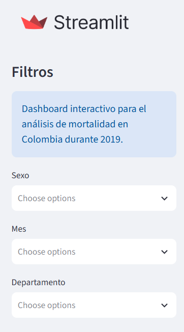
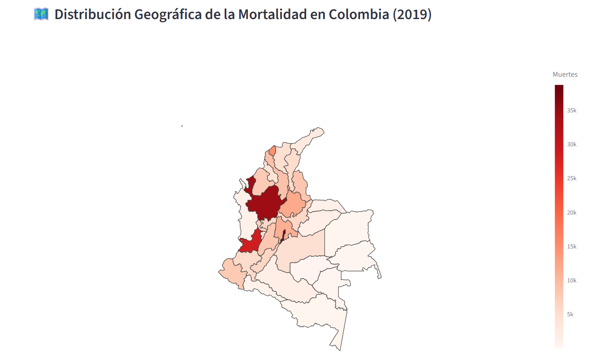
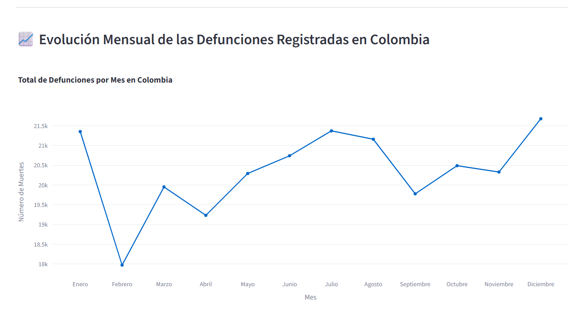
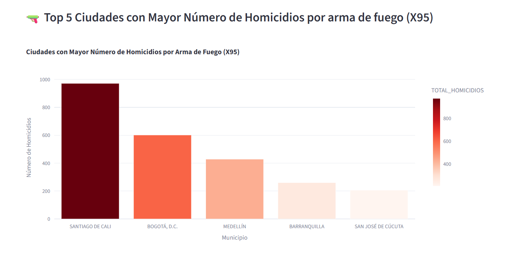
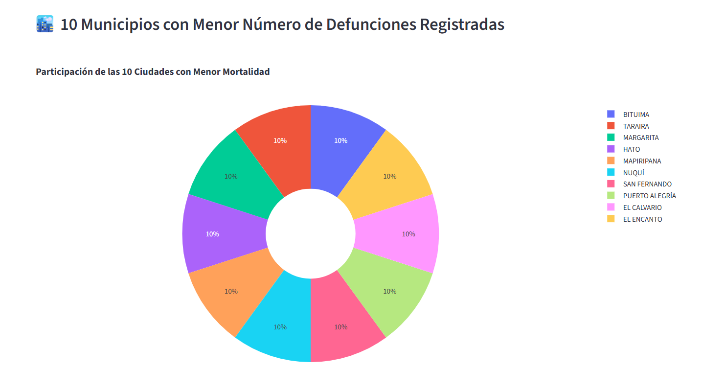
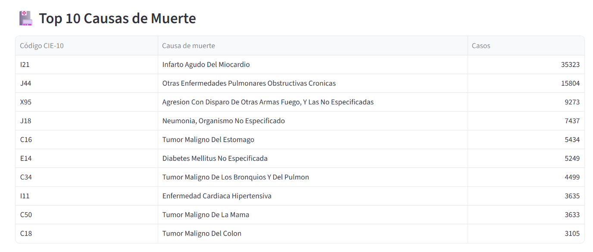
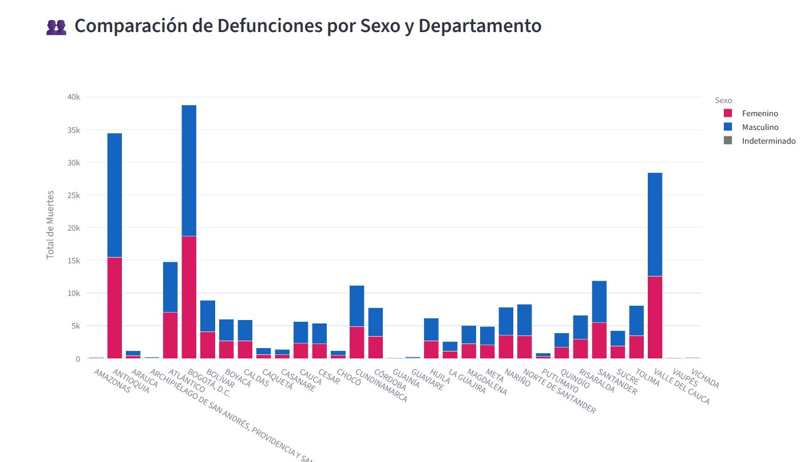
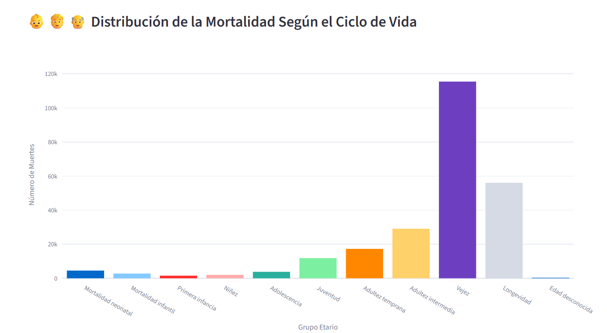

# Análisis de Mortalidad en Colombia - 2019

## Introducción

Este proyecto consiste en el desarrollo de una aplicación web interactiva para el análisis de la mortalidad en Colombia durante el año 2019, utilizando datos abiertos publicados por el Departamento Administrativo Nacional de Estadística (DANE).

La aplicación permite explorar patrones geográficos, temporales y demográficos mediante visualizaciones interactivas desarrolladas con Python, Streamlit y Plotly.


## Objetivo

Analizar el comportamiento de la mortalidad en Colombia durante el año 2019 mediante una aplicación web interactiva que facilite la exploración de patrones por departamento, municipio, sexo, edad y causa de muerte.

### Fuentes de información

- Defunciones No Fetales 2019 (DANE)
- Catálogo CIE-10 de causas de muerte
- DIVIPOLA (División Político Administrativa de Colombia)

## Estructura del proyecto

```text
Mortalidad-Colombia-2019/

│
├── app.py
├── requirements.txt
├── README.md
│
├── assets/
│ └── co_2018_MGN_DPTO_POLITICO.geojson
│
└── data/
├── Anexo1.NoFetal2019_CE_15-03-23.xlsx
├── Anexo2.CodigosDeMuerte_CE_15-03-23.xlsx
└── Divipola_CE_.xlsx
```

## Requisitos

```txt
streamlit
pandas
plotly
openpyxl
numpy
json
```

## Software utilizado

- Python
- Streamlit
- Plotly
- Pandas
- Json
- Visual Studio Code
- GitHub
- Render

## Instalación

Clonar repositorio:

```bash
git clone URL_DEL_REPOSITORIO
```

Ingresar al proyecto:

```bash
cd Mortalidad-Colombia-2019
```

Instalar dependencias:

```bash
pip install -r requirements.txt
```

Ejecutar aplicación:

```bash
streamlit run app.py
```


## Despliegue

La aplicación fue desplegada en Render utilizando un servicio web conectado directamente al repositorio de GitHub.

Comando de construcción:

pip install -r requirements.txt

Comando de inicio:

streamlit run app.py --server.port $PORT --server.address 0.0.0.0


## Visualizaciones

### Filtros 



Uso de filtros para un análisis mas detallado

### Mapa de mortalidad por departamento



Permite identificar los departamentos con mayor concentración de defunciones registradas durante 2019.

### Lineas defunciones por mes



Mediante este grafico podemos analizar el comportamiento y tendencia mensual de las defunciones en Colombia.

### Barras homicidios arma de fuego



En este grafico de barras identificamos que las grandes ciudades tienen una mayor cantidad de homicidios por arma de fuego destacando la ciudad de Cali.

### Circular menor numero de muertes



Se destacan municipios pequeños (1 muerte) como los que menos registraron muertes durante el 2019.

### Tabla top 10 causas muerte



Enfermedades pulmonares, casdiovasculares y ataques armados destacan como las principales causas de defunciones en Colombia.

### Barras Apiladas por sexo



Se puede analizar a nivel sexo y departamento que si existen diferencias en el numero de defunciones registradas por estas variables.


### Barras por grupo de edad



Se aprecia que hay un aumento de numero de defunciones a medida que avanzan los años, a partir de la adultez y con picos en grupos de vejez y longevidad (60+ años).

## Resultados principales

El análisis permitió identificar patrones geográficos, demográficos y epidemiológicos de mortalidad en Colombia durante 2019.

Se observó una concentración de defunciones en departamentos altamente poblados, predominio de muertes en edades avanzadas y diferencias territoriales en los homicidios por arma de fuego.